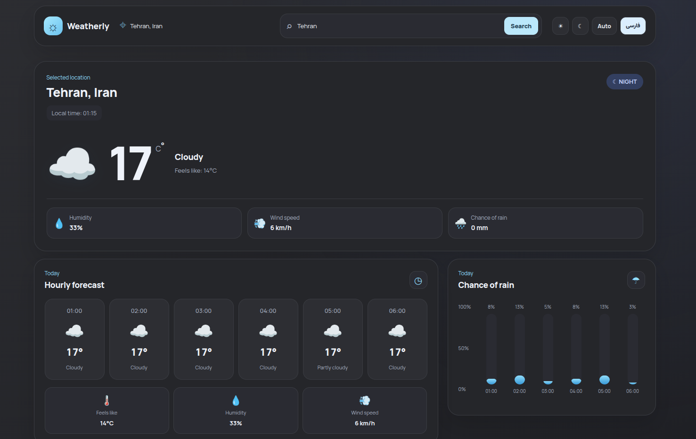

# Weatherly

A responsive weather application built with React and Vite, featuring real-time weather data, hourly forecasts, a 7-day forecast, and a bilingual interface.

**Live Demo:** [Open Weatherly](https://amirkhezry.github.io/weatherly/)


## Features

- Search for cities and view their weather information.
- Display current weather conditions and temperature.
- Explore hourly weather forecasts.
- View a 7-day weather forecast.
- Visualize precipitation probability.
- Switch between Persian and English.
- Choose Day, Night, or Auto theme modes.
- Explore recommended cities and select a city to view its weather.
- Responsive layout for desktop and mobile screens.
- Save the most recently selected city, language, and theme using localStorage.
- Fetch weather data without requiring an API key.

## Tech Stack

- React
- JavaScript
- Vite
- CSS
- Open-Meteo Geocoding API
- Open-Meteo Forecast API
- Browser localStorage
- Git and GitHub
- GitHub Pages

## Getting Started

### Prerequisites

- Node.js
- npm
- Git

### Installation

Clone the repository:

```bash
git clone https://github.com/amirkhezry/weatherly.git